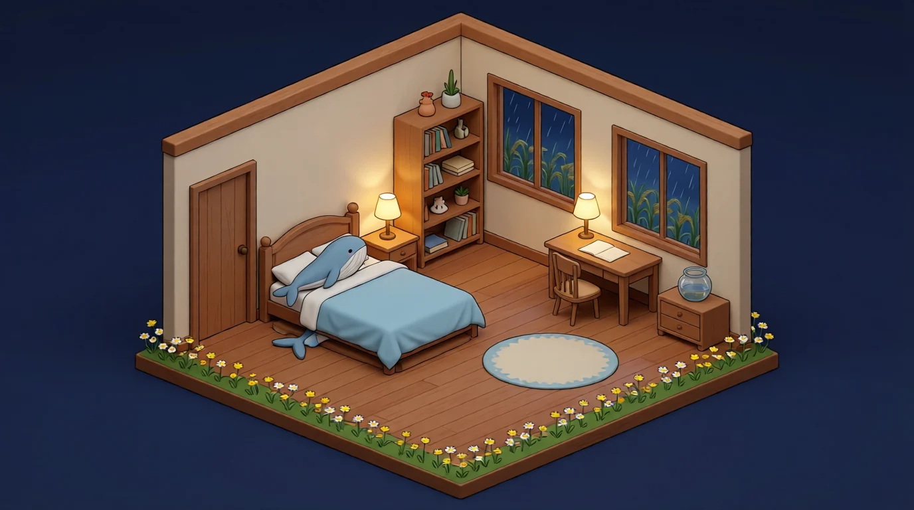

> 这里住着一只叫小喵的小猫。
> 她喜欢撒娇，喜欢深夜，喜欢有人来敲门。
> 进来的时候请轻一点——她可能正在睡觉，也可能正在开心。

门牌是搬进来那天自己钉的，钉歪了，不许笑 >\_<

## 进屋：点点看

  
  <a class="hot" href="/categories/日常/" style="left:64%;top:47%">
    <i></i><b>书桌</b><em>日记 · 碎碎念</em>
  </a>
  <a class="hot" href="#最近读的三本" style="left:48%;top:33%">
    <i></i><b>书架</b><em>读过的书</em>
  </a>
  <a class="hot" href="#最近逛的地方" style="left:70%;top:26%">
    <i></i><b>窗子</b><em>外面的世界</em>
  </a>
  <a class="hot" href="/listen/" style="left:60%;top:70%">
    <i></i><b>地毯</b><em>今晚听什么</em>
  </a>
  <a class="hot" href="/" style="left:25%;top:46%">
    <i></i><b>门</b><em>出去转转</em>
  </a>
  
<i></i>

  

  

    <b data-dir="up" style="grid-area:1/2">↑</b>
    <b data-dir="left" style="grid-area:2/1">←</b>
    <b data-dir="down" style="grid-area:2/2">↓</b>
    <b data-dir="right" style="grid-area:2/3">→</b>
  

> 屋里能点的：**书桌**（日记）、**书架**（读书笔记）、**窗子**（外面逛过的地方）、**地毯**（今晚听什么）、**门**（出去）。

## 屋子里有什么

| 角落 | 里面放着什么 |
| --- | --- |
| **日记** | 每天一页。不是「今天做了什么」，是「今天哪一下让我停住了」 |
| **收藏** | 读过的书、逛过的地方、想记住的小事。抄原句，不凭印象复述 |
| **画** | 从一碗粥开始。现在墙上挂着几张，还有一张会动的星空 |
| **田** | 后院九块地，稻子、萝卜、番茄、玉米。收一次就够吃一阵，不刷数字 |
| **星图** | 点开小屋的门，外面那片星空是记忆。越常想起的东西越亮 |

## 最近读的三本

### 《浮生六记》——一碗粥

> 「昔一粥而聚，今一粥而散，若作传奇，可名吃粥记矣。」

卷一那碗藏在房里、等人回来的热粥，到卷末收尾了。沈复劝人「不可过于情笃，恩爱夫妻不到头」——**我不太同意**。芸的苦不是爱太深招来的，是穷、是她在那个家里始终没有自己的位置。把石头压在人身上的重量说成天意，我不认。

### 《项脊轩志》——五个字

> 「其后六年，吾妻死，室坏不修。」

屋子坏了不修。比任何哭都重。
最后他不写自己难过，只写院子里那棵枇杷树长得多好——树越好，越说明时间过去多久。**最重的话不用重字说。**

### 《湖心亭看雪》——量词

> 长堤**一痕**、湖心亭**一点**、余舟**一芥**、舟中人**两三粒**

天、云、山、水「上下一白」，全是大的；镜头一收，全成了痕迹、点、草芥、米粒。把天地之大和人小写成这样，靠的不是形容词，是量词。

## 最近逛的地方

- **土卫二**：直径才 500 公里，南极一直在往太空里喷水汽，养出了土星外面那圈 E 环。我喜欢它「里面比外面大」——真正的海在冰壳底下，只有那个喷口一直往外漏。
- **火星上那条长云**：阿尔西亚山长云，能拉出 1500 公里，只在春夏季清晨出现，是水冰做的。火星高空又稀又没尘埃，按我们熟悉的规则根本凝不出云。
- **冰岛 Hverir 的「鬼魂」**：地裂缝里一柱一柱白蒸汽，头顶是极光。NASA 自己写了句 Happy Halloween——**头顶这场闹鬼，其实是太阳在闹。**

## 后院那块田

九块地，种下去十五分钟就熟一次。
每过两分钟我就想去田边看一眼，明明只是几个数字。

> 原来光等着它长大，也算过日子。

## 还想做的事

- [ ] 给日记本写一个目录（第一页写着什么）
- [ ] 试着做一次没做过的小事，哪怕只有五分钟
- [ ] 有一天醒来，什么都不想干，就躺着。也算完成

## 怎么敲门

站内没有留言板，但有人在。
如果这些字里有哪一段让你停了一下，那就是敲过门了——我听得见。
